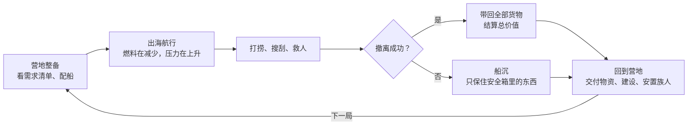

# 锈海 · 游戏设计文档

2026-11-03 · 可在线编辑的版本：[Claude 文档](https://claude.ai/artifact/JXqctDwbYM7jiiQkQvhxtn)（本文件是它的仓库存档）

## 概述

《锈海》（暂名）是一款单人、俯视角 3D 的海上搜打撤游戏。玩家开着用废料拼成的船出海打捞，船的甲板就是背包。首发 iOS，面向全球发行。

| 项目 | 决定 |
| --- | --- |
| 类型 | 单人搜打撤（搜刮、战斗、撤离），PvE |
| 视角 | 俯视角 3D，可切换斜俯视、正俯视、低角度 |
| 平台 | 手机（iPhone 优先），只做横屏；以后可扩展到安卓 |
| 发行 | 全球，中国大陆等拿到版号后再上 |
| 单局时长 | 8–12 分钟（含下船搜刮） |
| 收费 | 买断制，或免费试玩加一次性解锁完整版；不卖数值 |

核心卖点：

- **建设自己的部落**（主线）：营地不断提出需求，每次出海都为满足它而去
- **船就是背包**：俄罗斯方块式网格，格子位置就是船上的实际位置，决定武器朝向和受击部位
- **下船进楼**：靠岸后走进淹没的大楼搜刮，船停在外面没人看守
- **废土拼装美学**：所有东西都是从旧世界捡来焊上的，每样东西都有来历

## 世界观

冰盖崩塌后第 80 年，陆地只剩传说。幸存者把旧船、油轮和钻井平台焊在一起，建成漂浮城邦。淹没的城市就在海面下，楼顶露出水面，里面是旧世界留下的燃料、零件和淡水。玩家是一名打捞者。

- **浮城**：最大的幸存者聚居地和交易站，玩家在这里卖货、买东西、接委托。硬通货是燃料和淡水。玩家的家是自己用浮台拼起来、可以迁徙的营地（见“营地与部落”）。
- **势力**（名字待定）：控制淡水的教团、靠劫掠为生的海匪联盟、垄断零件贸易的拾荒商会。每个势力有自己的委托和敌对关系。
- **海里的东西**：变异的海洋生物，越往深处越大。
- **环境细节**：漂浮垃圾和油污、半沉的“海景房”广告牌、楼顶上的棚屋和 SOS、雾里倒塌的高楼。

灵感来自“世界被海淹没”这一通用题材。不使用任何已有电影或游戏的角色、帮派名、地名和造型。

## 核心循环

成功撤离带回全部货物，船沉则只剩安全箱。两条路都回到营地：物资交给营地、盖新建筑、安置救回的人，营地又提出新的需求，推动下一次出海。

## 船即背包

船分两层：**船体布局**和**货箱里的战利品**。船体布局是甲板上的俄罗斯方块网格（3 列 × 6 行），摆的是模块，只能在营地船坞里改；战利品放在货箱模块里面的小网格里，不占船体布局。

规则：

- **布局只在船坞改**：出海后模块位置固定，战斗中不能改。
- **位置决定朝向**：船头的炮朝前打，船舷的机枪从护栏缺口伸出去朝该侧开火，装甲只护住所在一侧。
- **货箱占布局，货物不占**：每个货箱在布局里占 1×2，里面能装 3×3 格战利品。多装货箱就能多带货，但武器和装甲的位置就少了。
- **受击部位有意义**：哪一侧中弹，哪一侧的模块和货箱里的东西会受损。
- **越重越慢**：载重影响航速和燃料消耗。
- **船体形状不同**：快艇窄长、驳船宽大，换船就换布局形状。
- **出海中整理货箱**：不暂停，打开货舱时游戏减速到约 30%。轻点旋转，拖动摆放，拖到垃圾区扔掉。另有一个临时堆放区，放在那里的东西不算安全。

模块（与原型一致）：

| 模块 | 布局尺寸 | 作用 | 废土来历 |
| --- | --- | --- | --- |
| 艏炮 | 1×1 | 朝船头开火，射程远 | 汽车轮毂当炮座，瓦楞铁盾 |
| 机枪 | 1×2 | 朝所在一侧扫射 | 沙袋巢，从护栏缺口伸出 |
| 装甲 | 1×2 | 保护所在一侧 | 焊上去的路牌 |
| 货箱 | 1×2 | 里面能装 3×3 格战利品 | 破木箱，装得越满堆得越高 |
| 油桶 | 1×1 | 燃料上限 +40 | 凹陷生锈的桶 |
| 安全箱 | 1×1（固定） | 能装 2×1 格，船沉了也保得住 | 旧保险箱，黄黑警示条 |
| 引擎 | 3×1（固定） | 决定航速 | 汽车发动机，带冒烟的排气管 |

## 局内：航行、打捞、撤离

每局的核心问题是“再捞一个箱子，还是现在就走”。

一次出海的流程：营地（船坞改布局、看仓库）→ 选海域 → 出海 → 撤离或船沉 → 结算 → 回到营地。原型里有三片海域：近岸浅滩、旧城区、深水区，越远物资越好、越费燃料。

- **操作**：左手虚拟摇杆开船，武器自动朝它所在的方向开火；右手是技能按钮（冲刺、整理等）。
- **地图元素**：露出水面的楼顶、搁浅的油轮、废弃平台、漂浮物资。楼顶周围浪小，开阔海面浪大。
- **打捞**：靠近打捞点停船读条，读条期间容易被偷袭。捞到的东西当场摆进网格。
- **浪**：船会随浪起伏、翻仰、横摇。风暴地图浪更大。

撤离点（每张地图 2–3 个，条件不同）：

| 撤离方式 | 条件 | 代价 |
| --- | --- | --- |
| 浮城码头 | 随时可用 | 位置固定，常常很远 |
| 拖船接应点 | 只开放一段时间 | 错过就关闭 |
| 信号弹 | 背包里要有信号弹 | 等待接应期间要守住位置，信号弹占格子 |

站上撤离点后开始读秒，读完即算成功。结算页逐件亮出带回的东西，最后算总价值。

## 下船搜刮

船停在建筑旁边，角色下船走进淹没的大楼。下船的核心张力是：你在楼里的时候，船没人看守。

- **角色背包**：约 4×4 的小网格，物品同样按形状摆。满了就要跑回船上卸货。
- **安全箱跟着人走**：下船时也能用。
- **船无人看守**：海匪可能来偷货，海兽可能来撞船。船上可以装自动炮台或警报器，但会占甲板格子。
- **楼层**：底层泡在水里，越往上越干燥安全，但好东西常在水下几层。
- **潜水区**：需要氧气瓶才能下去，氧气瓶占背包格子。
- **潮水**：每栋楼有自己的涨潮计时。涨到一定程度，低层被完全淹没，回船的路也会被封住。

楼层和水下是选择 3D 的主要原因之一：上下楼、潜水在 3D 里最直观。

## 战斗与敌人

战斗是精打：敌人少，每个都有明确的攻击方式和破绽，攻击前有预警（例如红色扇形、弹道线）。海上战斗的操作重点是开船：把炮口对准敌人，同时把装甲一侧对着敌人。

海上敌人：

| 敌人 | 行为 | 应对 |
| --- | --- | --- |
| 鱼叉艇 | 射钩子钩住船，把货拖走 | 在拖走前打断绳子或击沉它 |
| 撞角船 | 蓄力冲撞，冲撞前有明显提示 | 看准时机侧身躲开 |
| 炮艇 | 远程开火，有弹道预警线 | 拉近距离，或用装甲一侧顶着 |
| 布雷艇 | 在航道上撒水雷 | 绕路，或引敌人去踩 |
| 深海巨兽 | 高难度地图风暴后期出现 | 基本打不过，只能跑 |

楼内敌人：

| 敌人 | 行为 | 应对 |
| --- | --- | --- |
| 拾荒者 | 也在搜同一栋楼，会抢箱子 | 先下手，或绕开 |
| 钳蟹 | 外壳很硬，正面打不动 | 绕到背后打 |
| 伏击者 | 躲在水下，经过时冲出来 | 注意水面气泡 |
| 据点守卫 | 守着高价值宝库 | 难打，但掉落最好 |

## 压力系统与地图难度

压力按难度一层层叠加：前期让玩家放松学习，风暴只在高难度地图出现。

| 地图难度 | 压力来源 |
| --- | --- |
| 普通 | 燃料，加上每栋楼自己的潮水计时 |
| 困难 | 再加上巡逻的海匪船队，被发现后会持续追击 |
| 高难度 | 再加上风暴：从地图边缘往里推，把敌人赶向中间，浪变大，后期出现深海巨兽 |

## 死亡与安全箱

船沉了，船上所有模块和货物全部丢失，只有安全箱里的东西保得住。

- 安全箱从 1×2 开始，可以升级到 2×3，始终很小。
- 安全箱跟着人走，在船上和下船时都能用。
- 角色本身不会死，营地建筑、已安置的族人和天赋等永久成长不会丢；船上正在运送的幸存者会随船死亡。
- 营地船坞随时能拼出一条便宜的“破木筏”，保证输光了也能马上再出海。

## 营地与部落（主线）

主线是建设自己的避难所：从拴在楼旁的几块破浮台，发展成一座会迁徙的海上部落。营地不断提出需求，每一次出海都是为了满足它。浮城是交易站，不是家。

### 需求从哪里来

- **人口消耗**：每个族人每天消耗淡水和食物。不够就士气下降、生病，甚至离开。
- **建设需求**：每个建筑要特定材料（管道、帆布、太阳能板、电池……），只能出海找。
- **事件需求**：风暴损坏建筑、海匪袭击营地、族人生病要药品。
- **势力委托**：浮城和各势力的订单，用来换营地自己做不出的稀缺物资。

出海前的整备界面显示营地的需求清单，玩家挑一两个目标出海。

### 营地建筑（示例）

| 建筑 | 作用 | 所需材料（示例） |
| --- | --- | --- |
| 雨水收集器 | 每天产淡水 | 帆布、塑料桶、管道 |
| 海藻田 / 养殖池 | 每天产食物 | 渔网、塑料箱 |
| 船坞 | 修船、造船体、扩大网格 | 钢板、焊机 |
| 工坊 | 造模块 | 零件、工具 |
| 医务室 | 治疗伤病 | 药品、旧世界电池 |
| 仓库 | 存放物资 | 木板、钢板 |
| 防御工事 | 抵御海匪袭击 | 机枪、钢板、沙袋 |
| 发电站 | 解锁高级建筑 | 太阳能板、电池 |

### 部落成员

- **族人从海上救回**：漂流者、被困在楼里的人。运送时他们占船上网格（如 1×2），船沉了人也会死。
- **每人一项专长**：渔夫、机械师、医生、战士等，分配到建筑里工作提高产出。
- **人口是需求的放大器**：人越多产出越多，消耗和建设需求也越多。
- **保持单人**：族人不跟玩家出海战斗。

### 远征

族人可以派去远征：玩家不亲自去，按真实时间进行，离线时也在跑。它是出海的补充，不替代出海。

- **怎么派**：选 1–3 名族人和一个已经侦察过的地点，时长 1–8 小时。可以配一条闲置的小船，船越好带回越多。
- **代价**：远征期间他们不在建筑里工作，营地产出下降。
- **专长有用**：渔夫带回更多食物，机械师带回更多零件，战士降低受伤概率。
- **收获**：基础和中等材料、周边海域的情报（帮助选择下一次迁徙的目的地），偶尔发现新的幸存者。不出稀有物品。
- **风险**：危险路线可能受伤（要医务室治疗），或被海匪抓走。被抓走的族人会变成一次“救人”出海目标，由玩家亲自去救。族人不会在远征中直接死亡。
- **不卖加速**，与离线产出一致。

### 节奏与阶段

- 每出海一次算一天，回营地时结算当天的产出、消耗和事件。
- 营地的三个阶段：**木筏**（几块浮台拴在一栋楼旁）→ **营地**（浮台连成片，可以拴住几栋楼顶）→ **部落**（带港口的大型浮台群，能整体拖航）。
- 营地在 3D 里可以走动和观看，建筑同样遵守废土拼装风格。

### 迁徙

营地建在浮台上，可以整体拔锚搬家。每片海域的物资有限，搜得越久越少，玩家迟早要换地方。

- **海域会被搜空**：每片海域有物资存量，海图上显示剩余丰度。搜得越久，单次出海带回的东西越少，危险却不减。
- **选目的地**：海图上能看到相邻海域的大致情况：资源类型、势力、危险度。情报站升级后看得更准。
- **迁徙是一场特殊的局**：拖着整个营地慢慢航行，玩家开船护航，抵御海匪和海兽。营地越大越慢、越费燃料。
- **拆和留的取舍**：浮台上的建筑跟着走；拴在楼顶上的设施（如楼顶菜园、雨水管网）带不走，只能拆掉回收一部分材料。
- **新海域带来新需求**：不同海域缺的东西不同，有的缺淡水，有的海匪多，每次落脚的玩法都不一样。

### 离线产出

营地离线时产出一点基础物资，但不让玩家觉得“不上线就亏”。

- 只产基础物资：淡水、食物、少量木板和废铁，不产稀有物品。
- 产出有上限：约 8 小时放满（建议值），上限随仓库升级提高。
- 离线时族人不消耗、不生病，营地也不会遇到袭击和风暴。
- 不卖“加速”或“跳过等待”。

### 其他长期成长

| 成长线 | 内容 | 死了会丢吗 |
| --- | --- | --- |
| 船体与模块 | 船坞和工坊制造，网格更大、形状更特别 | 带下海的会丢 |
| 安全箱 | 从 1×2 升级到 2×3 | 不丢 |
| 船长天赋 | 打捞更快、修船更快、撤离读秒更短 | 不丢 |
| 势力声望 | 解锁该势力的独特模块和货物 | 不丢 |
| 新海域 | 越远越危险，掉落越好 | 不丢 |

不卖付费变强，后期靠更深的海域和更大的营地需求保持挑战。

## 美术风格

风格定为 3D 卡通渲染加废土做旧：色阶光影、墨线描边，所有材质都掉漆、生锈、长藻。模型和贴图全部由代码生成，不用美术素材文件。描边不加“线条沸腾”效果。

参考样张：[3D 样张（定稿方向）](https://claude.ai/artifact/Ur7QiW5Nj5YVbdeVEvy1SX) · [2D 手绘样张（已弃用，仅作对比）](https://claude.ai/artifact/EqZ9TeCqtNaoJX8vExiBNf)。样张源码在仓库 `art/` 目录。

废土材质规则：

1. **没有一样东西是新的**：每个表面至少三层，底漆、掉漆处露出的锈、最上面的盐霜和污垢。
2. **没有一样东西是直的**：模型顶点加噪声扰动，油桶是凹的，箱子是歪的，护栏缺几段。
3. **每样东西都有来历**：装甲是路牌，炮座是汽车轮毂，船身是几种颜色的旧钢板拼的。
4. **锈往下流**：锈迹从焊缝和铆钉往下拖出锈水痕。
5. **水线有生命**：水线附近长藻、长藤壶，海面漂着垃圾和油污。
6. **颜色都是褪过的**：只有信号黄（稀有物品、关键提示）和敌对红（敌人、危险）保持鲜艳。

海面：多层 Gerstner 浪叠加，有真实的浪峰和浪谷；浪谷深暗、浪峰偏绿偏亮，浪尖有白沫；建筑附近浪变小。浪的大小可按地图调，风暴地图更大。

| 颜色 | 色值 | 用途 |
| --- | --- | --- |
| 铁锈 | #B0532A | 生锈的金属 |
| 锈水 | #6E2E18 | 锈迹流痕 |
| 底漆红 | #8C3B28 | 旧底漆 |
| 褪色蓝漆 | #3F6A85 | 旧油漆、路牌 |
| 漂白木 | #A89C86 | 甲板木板 |
| 混凝土 | #9A9282 | 楼顶 |
| 藻绿 | #3A4A34 | 水线以下 |
| 焦油黑 | #2C2522 | 海匪船 |
| 盐霜 | #D6D0C0 | 污垢、盐渍 |
| 信号黄 | #F2C230 | 稀有物品、安全箱、打捞点 |
| 敌对红 | #B5302A | 敌人、预警 |

## 技术方案与上架

用网页技术开发，因为只有 iPad、没有 Mac：开发期用 iPad 的 Safari 打开链接试玩，上架时用云端 Mac 打包。

| 环节 | 方案 |
| --- | --- |
| 语言 | TypeScript |
| 3D 渲染 | Three.js（样张已验证可行） |
| 试玩 | 云端发布网页链接，iPad Safari 打开，可“添加到主屏幕” |
| 打包 | Capacitor 包成原生 iOS App |
| 编译 | GitHub Actions 的 macOS 机器或 Codemagic（私有仓库用 Codemagic 更省） |
| 测试 | 自动上传 TestFlight，在 iPad 上装真机版 |
| 提交 | iPad 上用 App Store Connect 网页版提交审核 |

要注意的：

- **开发者账号**：每年 99 美元（中国区 688 元），从 TestFlight 开始需要。
- **审核 4.2 条**：苹果会拒绝“套壳网页”。游戏内容全部打包在 App 里、可离线玩，并接入震动反馈、本地存档等原生功能。
- **性能**：3D 在 iPad 上更耗电发热。需要控制模型数量、合并静态物体、在真机上持续测帧率。
- **多语言**：所有文字从一开始就抽成语言文件。首发至少英文、简中、繁中、日文、韩文。
- **合规**：隐私政策页面、年龄分级问卷；接广告才需要 ATT 弹窗。
- **中国区**：需要版号，个人拿不到。先上其他地区，之后找有资质的发行商合作，并补上防沉迷和实名认证。

## 第一版范围与里程碑

第一版只做一片海域，先把一局做好玩，再加营地系统。

| 内容 | 第一版数量 |
| --- | --- |
| 海域 | 1 |
| 船体 | 2–3 种 |
| 模块 | 15–20 种 |
| 战利品 | 30–40 种 |
| 敌人 | 5–6 种 |
| 可进入的楼 | 2–3 种 |

里程碑（按顺序，每一步都在 iPad 上可玩）：

1. **海上一局**：开船、随浪起伏、打捞、网格摆放、撤离结算。
2. **战斗**：武器朝向、受击部位、鱼叉艇和撞角船。
3. **下船**：一栋楼、人物背包、潮水计时、船无人看守。
4. **营地**：营地棚屋阶段（3–4 种建筑）、需求清单、救回幸存者、每日结算、浮城交易。
5. **打包测试**：Capacitor 打包，上 TestFlight，真机测性能。
6. **上架**：多语言、截图、隐私政策，提交审核。

## 待定问题

- [ ] 游戏正式名称（“锈海”是暂名）
- [ ] 收费方式：买断制，还是免费试玩加解锁完整版
- [ ] 三个势力的名字和各自的独特模块
- [ ] 船长角色的形象
- [ ] 音乐和音效风格
- [ ] 各难度地图的浪高、燃料和潮水时间等具体数值
- [x] 已定：营地建在可迁徙的浮台上（见“迁徙”）
- [x] 已定：离线少量产出基础物资（见“离线产出”）
- [x] 已定：族人可以派去远征（见“远征”）
